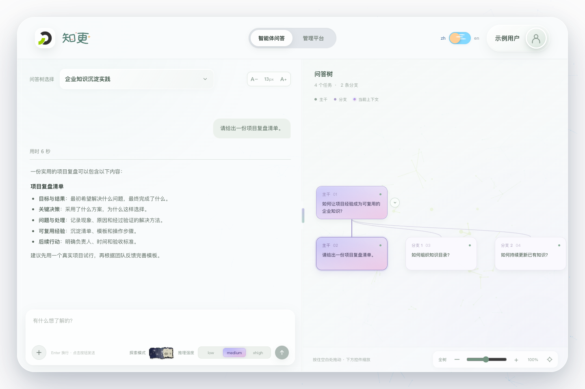
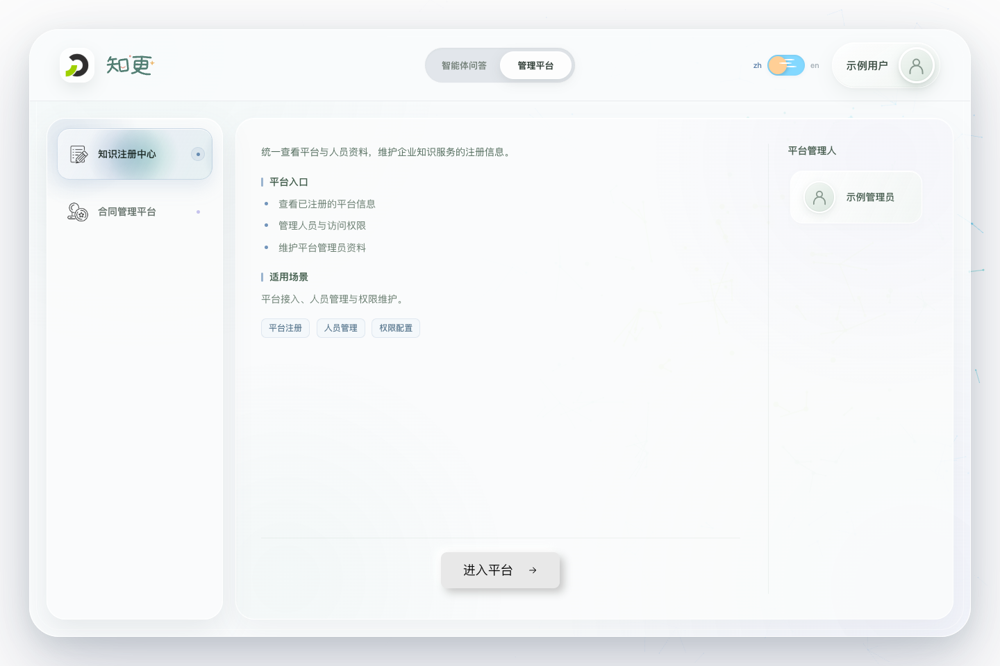
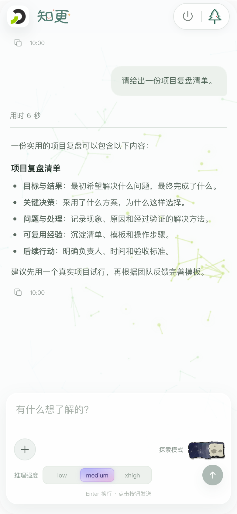

# 知更 · 企业知识统一入口

**知更（Zhigeng）** 为团队提供智能体问答、可追溯的问答树和管理平台统一入口。本仓库 `knowledge-accumulation-fe` 负责界面与交互，登录、身份、问答任务及平台目录由同级 [knowledge-accumulation-be](../knowledge-accumulation-be/description/project.md) 提供。

## 应用预览

以下截图来自当前应用界面，人员、问答与平台资料使用虚构示例数据，仅用于展示布局与交互，不代表真实业务结果或实际授权范围。

**桌面端 · 智能体问答与问答树**

左侧围绕当前上下文进行问答，右侧查看主干与分支，选择节点即可回看对应路径。



**桌面端 · 管理平台入口**

集中查看平台摘要、状态与管理人，并通过已配置的入口访问目标平台。



**移动端 · 随时继续探索**

移动端聚焦智能体问答，通过两侧抽屉访问会话列表与问答树。



## 主要能力

- **智能体问答**：流式回答、公开处理过程、停止生成与调整方向，支持附件上传和鉴权预览。
- **问答树**：沿主干推进或从已有节点展开分支，按所选路径保留上下文，恢复服务端历史。
- **会话管理**：移动端提供本地对话关键词搜索、会话置顶和多选删除。
- **平台入口**：展示后端返回的可见管理平台、Markdown 摘要与管理人，已配置注册中心和合同管理平台入口。
- **统一工作台**：钉钉免登、中英文切换、桌面与移动端适配，以及按用户隔离的页面状态缓存。

前端使用 **Vue 3 + Vite + JavaScript**，采用 ES Modules 与 `<script setup>`。当前使用 Hash 切换页面、Vue `KeepAlive` 保留状态、原生 Fetch 请求接口，未引入独立路由、全局状态库或 UI 组件库。

## 本地开发

```bash
npm install
# 首次运行时创建本机配置；已有 .env.local 时不要覆盖
cp .env.example .env.local
# 按所选登录方式填写 .env.local 后启动
npm run dev
```

开发服务监听 `15080`，端口被占用时不会自动切换：

- 本机地址：<http://localhost:15080/dev/knowledge-accumulation/>。
- 映射地址：<https://talent.szkl.com/dev/knowledge-accumulation/>。
- 默认后端：`http://127.0.0.1:15000`，通过 `KNOWLEDGE_BACKEND_URL` 配置代理目标。

登录方式与开发服务独立配置，`npm run dev` 始终保留热更新和 `/dev` 前缀：

| 登录方式 | 本机配置 | 说明 |
| --- | --- | --- |
| 钉钉免登（示例默认） | `VITE_AUTH_MODE=production`、`VITE_DINGTALK_CORP_ID` | 后端使用匹配的生产认证模式；在钉钉内联调 |
| 固定开发凭据 | `VITE_AUTH_MODE=development`、`KNOWLEDGE_DEVELOPER_LOGIN_CREDENTIAL` | 与后端开发凭据保持一致，仅用于开发服务 |

开发凭据只保存在被忽略的本机环境文件中，不使用 `VITE_` 前缀。钉钉应用密钥只保留在后端。详细配置与启动步骤见[统一登录](description/platform/authentication.md)，真实问答所需服务见[问答联调与初始化](description/platform/exploration-integration.md)。

## 验证与构建

| 命令 | 用途 |
| --- | --- |
| `npm run dev` | 启动开发服务 |
| `npm test` | 运行本地 Node 功能测试 |
| `npm run build` | 构建生产静态资源 |
| `npm run preview` | 本地预览生产构建产物 |

构建和预览仅允许生产认证模式，资源与 API 使用 `/knowledge-accumulation` 前缀。接口、资源路径及交互改动还需验证实际运行链路。

仓库使用 `.gitignore` 白名单，跟踪源码、部署配置、项目文档及引用的预览图；测试与模拟数据保留在开发者本地，部署仓库不包含测试集。`npm test` 适用于保留 `tests/*.test.js` 的开发目录。

## 部署与访问

生产部署使用根目录的 `Dockerfile` 和 `nginx.conf`，由同级 `knowledge-accumulation-deploy` 的 `knowledge-frontend` 服务统一编排。Compose 使用公开标识 `DINGTALK_CORP_ID`，映射至前端构建参数 `VITE_DINGTALK_CORP_ID`；独立 Vite/Docker 构建仍使用后者。代理、API/SSE 转发及缓存规则见[环境与部署](description/platform/deployment.md#docker-与-compose)。

钉钉移动端全屏入口：

- [开发环境](https://talent.szkl.com/dev/knowledge-accumulation/?dd_full_screen=true#assistant)
- [生产环境](https://talent.szkl.com/knowledge-accumulation/?dd_full_screen=true#assistant)

入口配置以[钉钉移动端全屏入口](description/platform/deployment.md#钉钉移动端全屏入口)为准。钉钉应用首页使用带 `dd_full_screen=true` 的地址；漏参时应用会尝试切换到全屏入口，失败或超时后继续加载当前页面。项目目录和 npm 包名为 `knowledge-accumulation-fe`，资源、API 与平台跳转路径沿用 `/knowledge-accumulation`，浏览器存储键保持兼容。

## 开发文档

| 文档 | 内容 |
| --- | --- |
| [项目总览](description/project.md) | 项目职责、架构与当前实现 |
| [文档导航](description/readme.md) | 功能、平台能力和后端契约入口 |
| [开发规范](AGENTS.md) | 代码、验证、文档与协作约定 |
| [智能体问答](description/features/assistant.md) | 问答树、上下文、附件与会话交互 |
| [管理平台入口](description/features/platforms.md) | 平台展示、入口配置与权限边界 |

开始开发前请阅读 `AGENTS.md` 和项目总览；涉及接口时核对后端文档、路由、Schema 与实际 OpenAPI。
